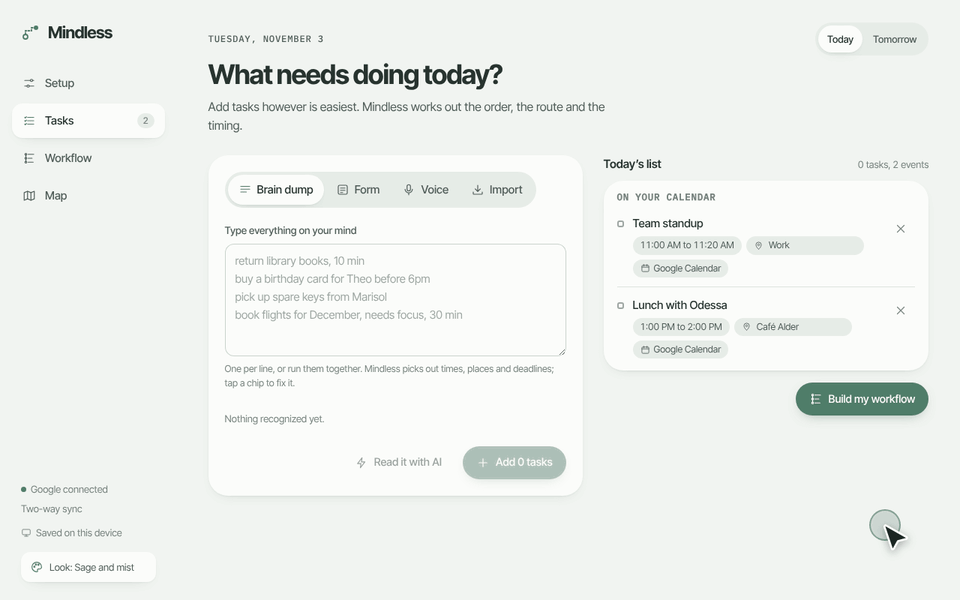
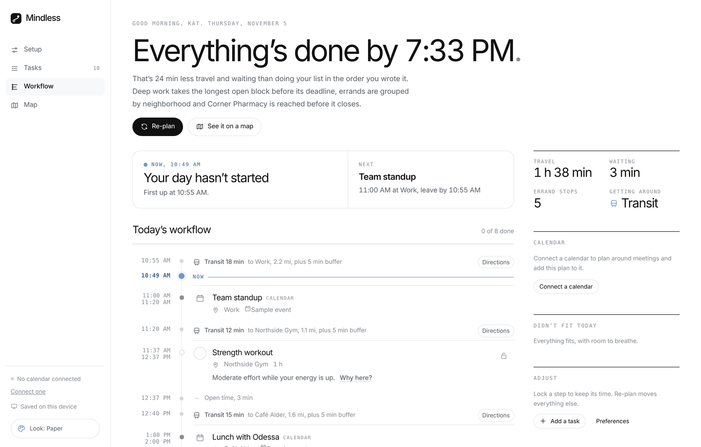
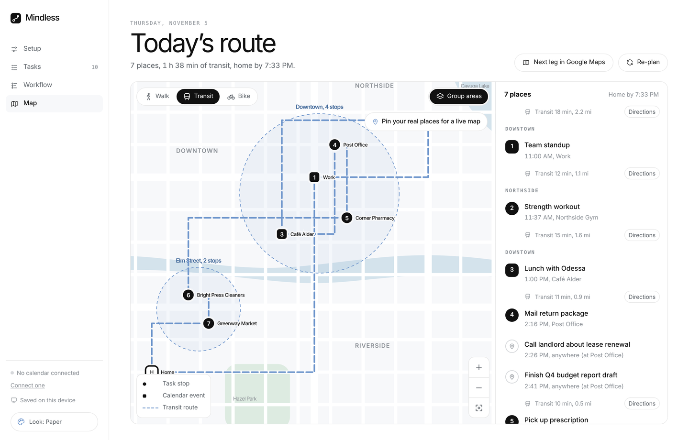
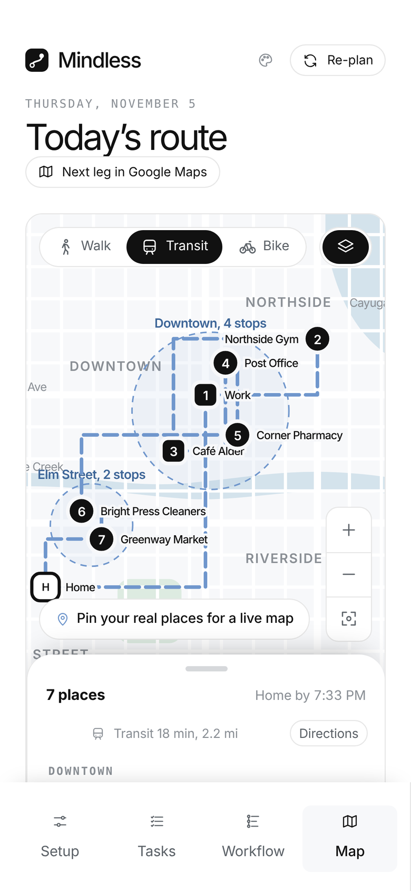

<p align="center"></p>

<h1 align="center">Mindless</h1>

<p align="center"><b>An AI day planner that works out the quickest, calmest way through everything on your list.</b></p>

You drop in your tasks however is easiest: a messy brain dump, a form, your voice, or a pasted list. Mindless weighs how long each one takes, where it happens, when places open and close, your deadlines, your calendar and when you focus best. It then builds an ordered plan with travel between stops and shows the route on a map.





| Route map | On a phone |
| --- | --- |
|  |  |

## What it does

- **Plans your day.** It orders tasks by travel, opening hours, deadlines, priority, breaks, buffers and your energy peak. Each step says why it sits where it does ("Grouped with your other Downtown stops").
- **Uses your real places.** Pin home, work and your regular spots by searching an address, using your current location, or tapping the map. Pinned places get real distances and travel times, and nearby pins are grouped into neighborhoods.
- **Shows the route.** A live street map (OpenStreetMap via Leaflet) shows your numbered stops, with an illustrated map as a fallback. Switch between walking, transit, biking and driving; on phones the stop list is a draggable sheet.
- **Hands off to Google Maps.** One tap opens the whole route, or any single leg, in Google Maps for turn-by-turn directions and live traffic.
- **Re-plans in one tap.** Running late, skipping something, a new task or a surprise meeting: Mindless previews what moves before you accept it, and you can undo.
- **Works with your calendar.** It reads Google Calendar events as busy time and writes the plan back as calendar blocks, which update when you re-plan.
- **Reads messy notes.** A built-in parser picks out durations, deadlines, places and "tonight". An optional AI read uses Claude for harder notes.
- **Remembers you.** Tasks, check-offs, places, preferences and recent days save privately to your account and follow you across devices.
- **Lets you choose the look.** There are seven color themes with light and dark modes, and six font pairings. The default, Paper, is white with black ink, hairline rules and Swiss type.

## How the planner works

`src/engine.js` is a pure, dependency-free scheduler:

1. **Greedy placement.** It walks forward through the day and scores each remaining task by travel cost, deadline urgency, opening-hour pressure, priority, energy fit and neighborhood grouping. Calendar events and locked steps act as fixed walls.
2. **Order search.** It uses local search plus 24 seeded random restarts over task orderings, keeping the plan with the lowest total cost (travel, waiting, missed deadlines, unscheduled work).
3. **Baseline check.** It compares the result against doing the list in the order it was written, which gives the "That's 40 min less travel" line.

For pinned places, distances are great-circle miles times a 1.3 street-detour factor, converted to minutes with per-mode city speeds. Unpinned places fall back to the illustrated map grid.

## Run it

Everything builds into a single self-contained page.

```bash
python3 build.py          # writes index.html
open index.html           # or serve the folder; GitHub Pages works too
node --test tests/*.test.js
```

Opened on its own, Mindless saves to your browser's local storage. Published as a [Claude](https://claude.ai) artifact, it also turns on:

| Capability | Used for |
| --- | --- |
| `db` + `user` | Private per-person storage that syncs across devices |
| `mcp` (Google Calendar) | Reading events, creating and deleting plan blocks |
| `sample` | "Read it with AI" for brain dumps |

Map tiles come from CARTO (OpenStreetMap data) and address search from OpenStreetMap Nominatim; no API keys are needed.

## Project layout

```
src/
  engine.js      scheduling and optimization (no DOM)
  maps.js        live map, location, address search, Google Maps links
  app.js         UI, state, storage, calendar and AI integrations
  style.css      design tokens, themes and layout
  template.html  page shell
vendor/          Leaflet 1.9.4 (BSD-2-Clause), inlined at build time
tests/           engine tests (node:test)
build.py         bundles src/ into index.html
docs/            screenshots
```

## Limits, honestly

- Travel times are estimates from real distances, not live traffic or transit schedules. Google Maps links give the live version.
- The live map draws straight lines between stops rather than the street route.
- Inside Claude, the live map, address search and location depend on what the page is allowed to reach. If any are blocked, Mindless falls back to the illustrated map and tap-to-pin.
- Apple Calendar and Outlook aren't connected yet.
- Voice input depends on the browser's speech recognition (Chrome, Edge, Safari).

## Built with

Vanilla JavaScript, HTML and CSS plus Leaflet for the live map, with no framework or build dependencies beyond Python for bundling. The design was explored first as a clickable prototype and a Figma design system with variables for themes, fonts and spacing.
